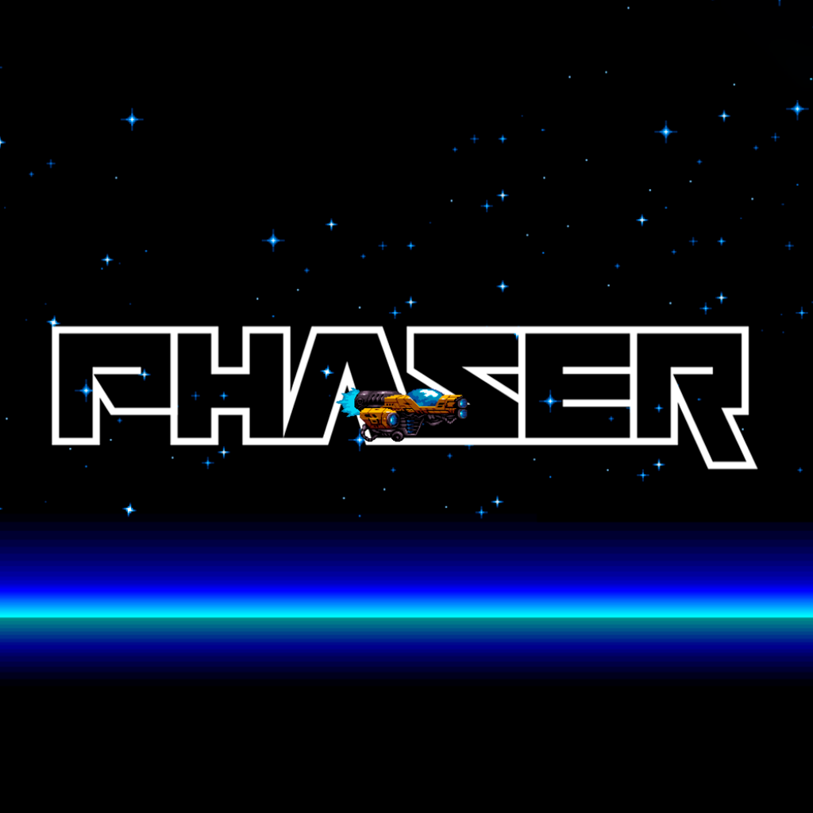

# Candy Catch 🍬

A browser arcade game built with **JavaScript** and the **Phaser 3** game engine. Move the basket to catch as many falling candies as you can before the 30-second timer runs out.

**▶ Play it live:** https://naveen1801.github.io/candy_catcher_game/



## How to play

- Click **Play** on the title screen
- Use the **← / →** arrow keys to move the basket
- Each candy you catch is worth **+10 points**
- When the **30-second** timer ends you see your final score, then click to play again

## Features

- **Three scenes:** Title → Game → Game Over, built with Phaser's scene system
- **Arcade physics:** candies fall under gravity, and overlap detection registers each catch
- **Real-time game loop:** keyboard input, a countdown timer and a live score display
- **Sprite sheets and audio:** varied candy sprites from a sprite sheet, background music and a "pop" sound on each catch
- **Responsive canvas:** a 1280×720 game that scales to fit any screen size (`Phaser.Scale.FIT`)

## Tech stack

JavaScript (ES modules) · Phaser 3 · HTML5 Canvas / WebGL

## Project structure

```text
candy_catcher_game/
├─ index.html              # Loads Phaser and the game
├─ phaser.js               # Phaser 3 engine
├─ src/
│  ├─ main.js              # Game config (size, physics, scenes)
│  └─ scenes/
│     ├─ TitleScene.js
│     ├─ GameScene.js      # Basket movement, candy spawning, scoring, timer
│     └─ GameOverScene.js
└─ assets/                 # Images, sprite sheets, audio
```

## Run locally

ES modules need a local web server, so opening `index.html` directly won't work:

```bash
npx serve .
# or: python -m http.server 8000
```

Then open the URL it prints.

## Author

**Naveen Agarwal**, B.E. Computer Science and Engineering, SSN College of Engineering
[GitHub](https://github.com/naveen1801) · [LinkedIn](https://linkedin.com/in/naveen-agarwal-262b1b29a)
